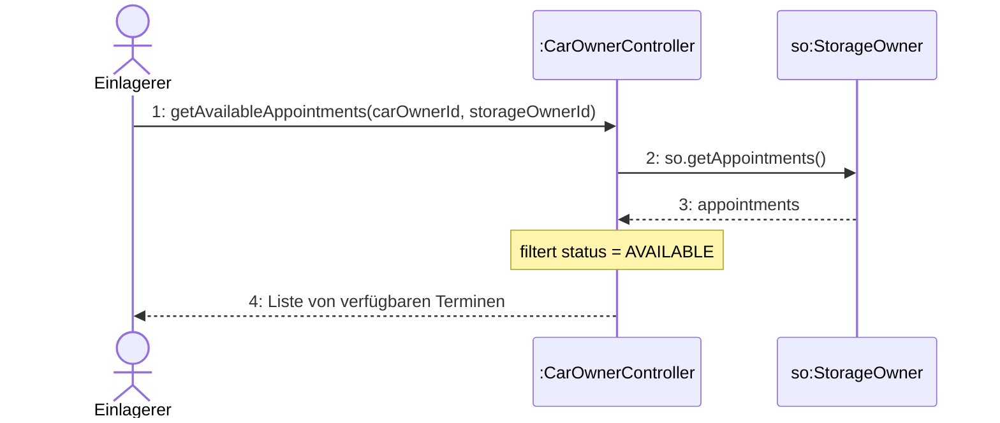
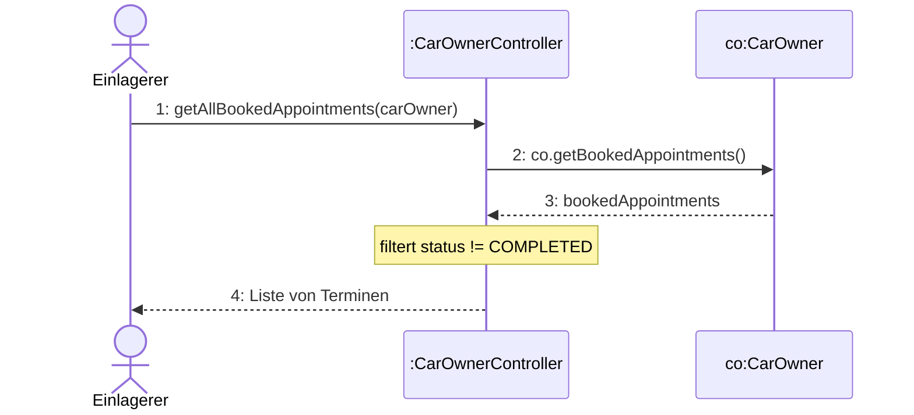
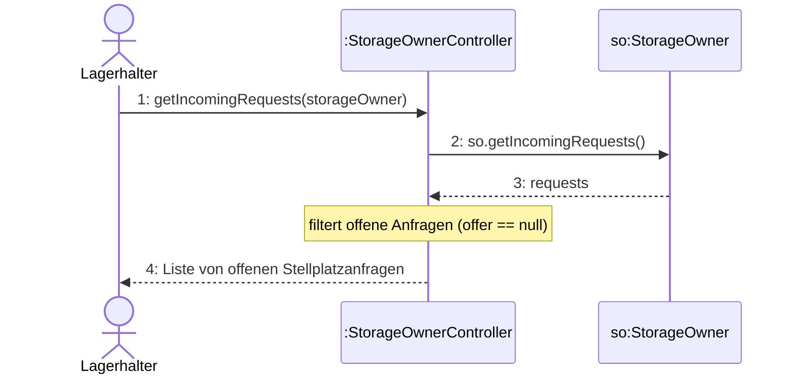
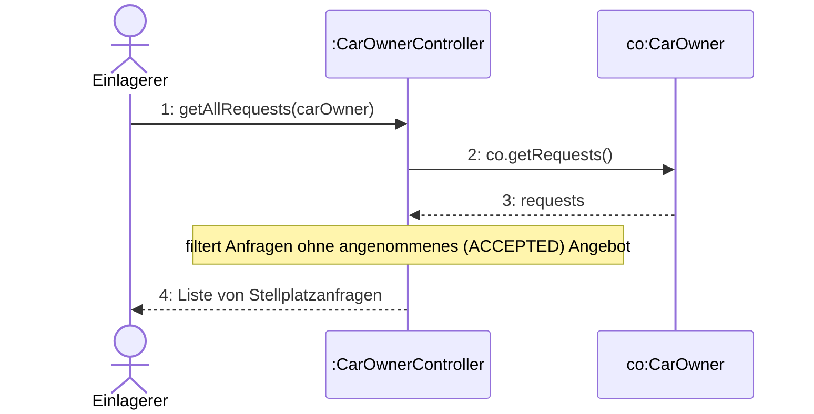
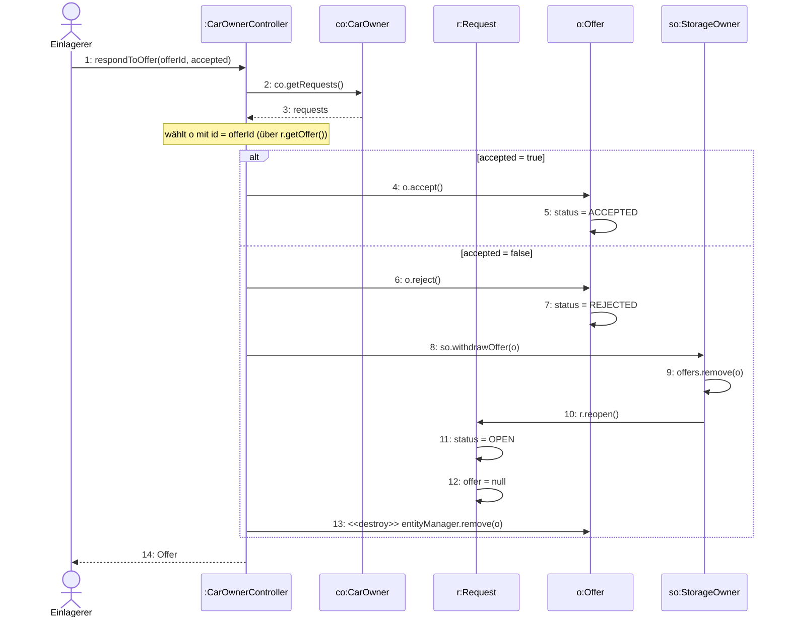

# Software-Entwurf – Ergänzungen (Contracts & Interaktionsdiagramme)

Abgleich des Entwurfs (Stand 22. Juni 2026) gegen die aktuelle Implementierung.
Enthält **nur** die Contracts, die neu sind oder inhaltlich geändert werden müssen,
sowie die dazugehörigen Interaktionsdiagramme (neu bzw. angepasst).

## Nummerierungs-Hinweis (wichtig)

Im überarbeiteten UC_E5-Sequenzdiagramm ist `completeAppointment` als
`CO_UC_E5_6` beschriftet – diese Nummer hat aber bereits `getAllAppointments`.

Empfehlung (minimalinvasiv, **kein** Umnummerieren bestehender Contracts):

- `completeAppointment` → neuer Contract **`CO_UC_E5_8`**
- `deleteAppointment` bleibt **`CO_UC_E5_7`**
- Im UC_E5-Sequenzdiagramm die Beschriftung `CO_UC_E5_6: completeAppointment`
  auf `CO_UC_E5_8: completeAppointment` ändern.

## Übersicht der Änderungen

| Contract | Art | Grund |
|---|---|---|
| CO_UC_E5_3 bookAppointment | geändert | Umlagerung erfolgt in `complete()`, nicht in `book()`; neue Guards |
| CO_UC_E5_5 cancelAppointment | geändert | Slot wird auf `AVAILABLE` recycelt (nicht `CANCELLED`) + Zuordnungen gelöst |
| CO_UC_E5_7 deleteAppointment | geändert | Gebuchte (BOOKED) Termine sind nicht löschbar |
| CO_UC_E5_8 completeAppointment | **neu** | Abschluss + eigentliche Umlagerung (EIN-/AUSLAGERUNG) |
| CO_UC_E2_2 getAllRequests | geändert | Anfragen mit angenommenem Angebot werden ausgeblendet |
| CO_UC_L7_1 getIncomingRequests | geändert | nur offene Anfragen (ohne Angebot) im Eingang |
| CO_UC_E3_2 respondToOffer | geändert | Ablehnung löscht Angebot und gibt Anfrage wieder frei |

Fehlende Interaktionsdiagramme (Contract vorhanden, Diagramm fehlte bislang):
`getAvailableAppointments`, `bookAppointment`, `getAllBookedAppointments`,
`cancelAppointment` sowie neu `completeAppointment`.

---

# 1. Operationelle Verträge (LaTeX)

```latex
% ------------------------------------------------------------------------------
% CO_UC_E5_3 – bookAppointment  (GEÄNDERT)
% ------------------------------------------------------------------------------
\phantomsection
\addcontentsline{toc}{subsubsection}{CO\_UC\_E5\_3}
\begin{longtable}{|L|R|}
\hline
\rowcolor{tableHeader}
\textbf{Contract} & \textbf{CO\_UC\_E5\_3: bookAppointment} \\ \hline
Operation & bookAppointment(storageOwnerId, carId, type, date, time) \\ \hline
Querverweis & UC\_E5 – Ein- \& Auslagerungstermin koordinieren \\ \hline
Vorbedingung &
\begin{itemize}[label=\checkmark, nosep, leftmargin=*]
    \item Der Einlagerer besitzt bei \underline{so} ein angenommenes (ACCEPTED) Angebot.
    \item [type = EINLAGERUNG] \underline{c} ist aktuell nicht eingelagert (\underline{c}.currentStorage = null).
    \item [type = EINLAGERUNG] Für \underline{c} besteht kein weiterer gebuchter Einlagerungstermin (BOOKED).
    \item Es existiert ein verfügbarer Termin \underline{a} von \underline{so} mit passendem type, date und time (\underline{a}.status = AVAILABLE).
\end{itemize} \\ \hline
Nachbedingung &
\begin{itemize}[label=\checkmark, nosep, leftmargin=*]
    \item \underline{a}.status wurde auf BOOKED gesetzt.
    \item \underline{a}.carOwner wurde mit \underline{co} verknüpft.
    \item \underline{a}.subject wurde mit \underline{c} verknüpft.
    \item \underline{co}.bookedAppointments wurde um \underline{a} erweitert.
\end{itemize} \\ \hline
\multicolumn{2}{|p{\dimexpr\linewidth-2\tabcolsep}|}{\footnotesize Hinweis: Die eigentliche Umlagerung (currentStorage / storedCars) erfolgt erst beim Abschluss des Termins, siehe CO\_UC\_E5\_8 (completeAppointment).} \\ \hline
\end{longtable}
\newpage

% ------------------------------------------------------------------------------
% CO_UC_E5_5 – cancelAppointment  (GEÄNDERT)
% ------------------------------------------------------------------------------
\phantomsection
\addcontentsline{toc}{subsubsection}{CO\_UC\_E5\_5}
\begin{longtable}{|L|R|}
\hline
\rowcolor{tableHeader}
\textbf{Contract} & \textbf{CO\_UC\_E5\_5: cancelAppointment} \\ \hline
Operation & cancelAppointment(appointmentId) \\ \hline
Querverweis & UC\_E5 – Ein- \& Auslagerungstermin koordinieren \\ \hline
Vorbedingung &
\begin{itemize}[label=\checkmark, nosep, leftmargin=*]
    \item \underline{a}.status ist nicht COMPLETED (abgeschlossene Termine können nicht storniert werden).
\end{itemize} \\ \hline
Nachbedingung &
\begin{itemize}[label=\checkmark, nosep, leftmargin=*]
    \item \underline{a}.carOwner wurde auf null gesetzt.
    \item \underline{a}.subject wurde auf null gesetzt.
    \item \underline{a}.status wurde auf AVAILABLE gesetzt (der Slot ist wieder buchbar).
    \item \underline{a} wurde aus \underline{co}.bookedAppointments entfernt.
\end{itemize} \\ \hline
\end{longtable}
\newpage

% ------------------------------------------------------------------------------
% CO_UC_E5_7 – deleteAppointment  (GEÄNDERT)
% ------------------------------------------------------------------------------
\phantomsection
\addcontentsline{toc}{subsubsection}{CO\_UC\_E5\_7}
\begin{longtable}{|L|R|}
\hline
\rowcolor{tableHeader}
\textbf{Contract} & \textbf{CO\_UC\_E5\_7: deleteAppointment} \\ \hline
Operation & deleteAppointment(appointmentId) \\ \hline
Querverweis & UC\_E5 – Ein- \& Auslagerungstermin koordinieren \\ \hline
Vorbedingung &
\begin{itemize}[label=\checkmark, nosep, leftmargin=*]
    \item \underline{a}.status ist nicht BOOKED (gebuchte Termine können nicht gelöscht werden).
\end{itemize} \\ \hline
Nachbedingung &
\begin{itemize}[label=\checkmark, nosep, leftmargin=*]
    \item \underline{a} wurde aus \underline{so}.appointments entfernt.
\end{itemize} \\ \hline
\end{longtable}
\newpage

% ------------------------------------------------------------------------------
% CO_UC_E5_8 – completeAppointment  (NEU)
% ------------------------------------------------------------------------------
\phantomsection
\addcontentsline{toc}{subsubsection}{CO\_UC\_E5\_8}
\begin{longtable}{|L|R|}
\hline
\rowcolor{tableHeader}
\textbf{Contract} & \textbf{CO\_UC\_E5\_8: completeAppointment} \\ \hline
Operation & completeAppointment(appointmentId) \\ \hline
Querverweis & UC\_E5 – Ein- \& Auslagerungstermin koordinieren \\ \hline
Vorbedingung &
\begin{itemize}[label=\checkmark, nosep, leftmargin=*]
    \item \underline{a}.status = BOOKED (nur gebuchte Termine können abgeschlossen werden).
\end{itemize} \\ \hline
Nachbedingung &
\begin{itemize}[label=\checkmark, nosep, leftmargin=*]
    \item [type = EINLAGERUNG] \underline{c}.currentStorage wurde auf \underline{so} gesetzt.
    \item [type = EINLAGERUNG] \underline{so}.storedCars wurde um \underline{c} erweitert.
    \item [type = AUSLAGERUNG] \underline{c}.currentStorage wurde auf null gesetzt.
    \item [type = AUSLAGERUNG] \underline{c} wurde aus \underline{so}.storedCars entfernt.
    \item \underline{a}.status wurde auf COMPLETED gesetzt.
\end{itemize} \\ \hline
\end{longtable}
\newpage

% ------------------------------------------------------------------------------
% CO_UC_E2_2 – getAllRequests  (GEÄNDERT)
% ------------------------------------------------------------------------------
\phantomsection
\addcontentsline{toc}{subsubsection}{CO\_UC\_E2\_2}
\begin{longtable}{|L|R|}
\hline
\rowcolor{tableHeader}
\textbf{Contract} & \textbf{CO\_UC\_E2\_2: getAllRequests} \\ \hline
Operation & getAllRequests(carOwnerId) \\ \hline
Querverweis & UC\_E2 – Stellplatzangebot anfordern \\ \hline
Nachbedingung &
\begin{itemize}[label=\checkmark, nosep, leftmargin=*]
    \item Alle Stellplatzanfragen von \underline{co} ohne angenommenes Angebot wurden zurückgegeben (Anfragen mit ACCEPTED-Angebot werden ausgeblendet).
\end{itemize} \\ \hline
\end{longtable}
\newpage

% ------------------------------------------------------------------------------
% CO_UC_L7_1 – getIncomingRequests  (GEÄNDERT)
% ------------------------------------------------------------------------------
\phantomsection
\addcontentsline{toc}{subsubsection}{CO\_UC\_L7\_1}
\begin{longtable}{|L|R|}
\hline
\rowcolor{tableHeader}
\textbf{Contract} & \textbf{CO\_UC\_L7\_1: getIncomingRequests} \\ \hline
Operation & getIncomingRequests(storageOwnerId) \\ \hline
Querverweis & UC\_L7 – Stellplatzanfragen verwalten \\ \hline
Nachbedingung &
\begin{itemize}[label=\checkmark, nosep, leftmargin=*]
    \item Alle offenen eingehenden Stellplatzanfragen von \underline{so} (ohne bestehendes Angebot, \underline{r}.offer = null) wurden zurückgegeben.
\end{itemize} \\ \hline
\end{longtable}
\newpage

% ------------------------------------------------------------------------------
% CO_UC_E3_2 – respondToOffer  (GEÄNDERT)
% ------------------------------------------------------------------------------
\phantomsection
\addcontentsline{toc}{subsubsection}{CO\_UC\_E3\_2}
\begin{longtable}{|L|R|}
\hline
\rowcolor{tableHeader}
\textbf{Contract} & \textbf{CO\_UC\_E3\_2: respondToOffer} \\ \hline
Operation & respondToOffer(offerId, accepted) \\ \hline
Querverweis & UC\_E3 – Stellplatzangebote verwalten \\ \hline
Nachbedingung &
\begin{itemize}[label=\checkmark, nosep, leftmargin=*]
    \item [accepted = true] \underline{o}.status wurde auf ACCEPTED gesetzt.
    \item [accepted = false] \underline{o} wurde aus \underline{so}.offers entfernt und dauerhaft gelöscht.
    \item [accepted = false] Die zugehörige Anfrage \underline{r} wurde wieder freigegeben (\underline{r}.status = OPEN, \underline{r}.offer = null).
\end{itemize} \\ \hline
\end{longtable}
\newpage
```

---

# 2. Interaktionsdiagramme (Mermaid)

> Reihenfolge-Empfehlung im Kapitel 4: die vier fehlenden Einlagerer-Termin-
> Operationen bei den bestehenden Termin-Diagrammen einsortieren
> (nach `createAppointment`), `completeAppointment` vor `deleteAppointment`.

## 2.1 getAvailableAppointments (neu)



## 2.2 bookAppointment (neu)

```mermaid
sequenceDiagram
    actor Einlagerer
    participant C as :CarOwnerController
    participant co as co:CarOwner
    participant so as so:StorageOwner
    participant a as a:Appointment

    Einlagerer->>C: 1: bookAppointment(storageOwnerId, carId, type, date, time)
    C->>co: 2: co.getRequests()
    co-->>C: 3: requests
    Note over C: prüft akzeptiertes (ACCEPTED) Angebot bei so
    C->>co: 4: co.getCars()
    co-->>C: 5: cars
    Note over C: wählt c mit id = carId;<br/>[EINLAGERUNG] c nicht eingelagert &<br/>keine offene Einlagerung (BOOKED)
    C->>so: 6: so.getAppointments()
    so-->>C: 7: appointments
    Note over C: wählt verfügbaren Termin a (AVAILABLE, type, date, time)
    C->>a: 8: a.book(co, c)
    a->>a: 9: carOwner = co
    a->>a: 10: subject = c
    a->>a: 11: status = BOOKED
    C->>co: 12: co.addAppointment(a)
    co->>co: 13: bookedAppointments.add(a)
    C-->>Einlagerer: 14: Appointment
```

## 2.3 getAllBookedAppointments (neu)



## 2.4 cancelAppointment (neu)

```mermaid
sequenceDiagram
    actor Einlagerer
    participant C as :CarOwnerController
    participant co as co:CarOwner
    participant a as a:Appointment

    Einlagerer->>C: 1: cancelAppointment(appointmentId)
    C->>co: 2: co.getBookedAppointments()
    co-->>C: 3: bookedAppointments
    Note over C: wählt a mit id = appointmentId;<br/>prüft status != COMPLETED
    C->>a: 4: a.cancel()
    a->>a: 5: carOwner = null
    a->>a: 6: subject = null
    a->>a: 7: status = AVAILABLE
    C->>co: 8: co.removeAppointment(a)
    co->>co: 9: bookedAppointments.remove(a)
    C-->>Einlagerer: 10: Stornierung bestätigt
```

## 2.5 completeAppointment (neu)

```mermaid
sequenceDiagram
    actor Lagerhalter
    participant C as :StorageOwnerController
    participant so as so:StorageOwner
    participant a as a:Appointment
    participant c as c:Car

    Lagerhalter->>C: 1: completeAppointment(appointmentId)
    C->>so: 2: so.getAppointments()
    so-->>C: 3: appointments
    Note over C: wählt a mit id = appointmentId;<br/>prüft status = BOOKED
    C->>a: 4: a.complete()
    a->>c: 5: c.relocateTo(so)
    Note over a,c: [EINLAGERUNG] relocateTo(so);<br/>[AUSLAGERUNG] relocateTo(null)
    c->>so: 6: so.addCarToStorage(c)
    so->>c: 7: c.setCurrentStorage(so)
    so->>so: 8: storedCars.add(c)
    a->>a: 9: status = COMPLETED
    C-->>Lagerhalter: 10: Appointment
```

> Variante AUSLAGERUNG: `c.relocateTo(null)` ruft
> `so.removeCarFromStorage(c)` → `c.setCurrentStorage(null)` +
> `storedCars.remove(c)`; anschließend `status = COMPLETED`.

## 2.6 getIncomingRequests (angepasst – Filter)



## 2.7 getAllRequests (angepasst – Filter)



## 2.8 respondToOffer (angepasst – Ablehnung löscht + gibt Anfrage frei)



## 2.9 deleteAppointment (angepasst – BOOKED-Guard)

```mermaid
sequenceDiagram
    actor Lagerhalter
    participant C as :StorageOwnerController
    participant so as so:StorageOwner
    participant a as a:Appointment

    Lagerhalter->>C: 1: deleteAppointment(appointmentId)
    C->>so: 2: so.getAppointments()
    so-->>C: 3: appointments
    Note over C: wählt a mit id = appointmentId;<br/>prüft status != BOOKED (sonst Konflikt)
    C->>so: 4: so.removeAppointment(a)
    so->>so: 5: appointments.remove(a)
    C-->>Lagerhalter: 6: Löschen bestätigt
```

---

# 3. Entwurfsklassendiagramm (Mermaid)

Korrekturen gegenüber dem bisherigen Diagramm (S. 58):

- `StorageOwner`: `serviceTime : LocalTime` → **`serviceStartTime`** + **`serviceEndTime`**
  (2 Felder); `updateProfile`-Signatur entsprechend erweitert.
- `Car`: **`category : CarCategory`** und **`manufacturer : String`** ergänzt,
  inkl. `changeCategory` / `changeManufacturer`; `registerCar`-Signatur erweitert.
- `AppointmentStatus`: **`COMPLETED`** ergänzt.
- `Appointment`: **`complete()`** ergänzt (führt die Umlagerung durch).
- `StorageOwnerController`: **`completeAppointment(appointmentId)`** ergänzt;
  `updateService` mit `serviceId`.
- `CarOwnerController`: `createCar` / `updateCar` mit `category`, `manufacturer`.
- `User`: **`passwordVersion : int`** ergänzt.
- `Request`: **`reopen()`** ergänzt.
- `StorageOwner`: `removeOffer` → **`withdrawOffer`** (gibt zugehörige Anfrage frei).
- `CarOwner`: **`removeAppointment(appointment)`** ergänzt.

```mermaid
classDiagram
    direction TB

    %% ------------------------- Controller -------------------------
    class AuthController {
        +authenticate(email, password)
    }

    class CarOwnerController {
        +createCarOwner(email, password, firstName, lastName)
        +getCarOwner(id) CarOwner
        +updateCarOwner(email, password, firstName, lastName)
        +searchByCity(city) List~StorageOwner~
        +createCar(licensePlate, category, manufacturer) Car
        +getAllCars(carOwner) List~Car~
        +updateCar(carId, licensePlate, category, manufacturer) Car
        +removeCar(carId)
        +bookOptionalService(carId, storageOwnerId, serviceId) Car
        +removeBookedService(carId, serviceId)
        +createRequest(storageOwnerId, description) Request
        +getAllRequests(carOwner) List~Request~
        +deleteRequest(requestId)
        +getReceivedOffers(carOwner) List~Offer~
        +respondToOffer(offerId, accepted) Offer
        +getAvailableAppointments(carOwnerId, storageOwnerId) List~Appointment~
        +bookAppointment(storageOwnerId, carId, type, date, time) Appointment
        +getAllBookedAppointments(carOwner) List~Appointment~
        +cancelAppointment(appointmentId)
    }

    class StorageOwnerController {
        +createStorageOwner(email, password, companyName, costs, serviceStartTime, serviceEndTime, location, storage, carManufacturers)
        +getStorageOwner(id) StorageOwner
        +updateStorageOwner(email, password, companyName, costs, serviceStartTime, serviceEndTime, location, storage, carManufacturers)
        +getAllServices(storageOwner) List~Service~
        +getOptionalServices(storageOwner) List~Service~
        +createService(title, description, price, isOptional) Service
        +updateService(serviceId, title, description, price, isOptional) Service
        +deleteService(serviceId)
        +getStoredCars(storageOwner) List~Car~
        +updateStoredCarStatus(carId, readyToDrive, isMaintained) Car
        +getIncomingRequests(storageOwner) List~Request~
        +createOffer(requestId, description, costs) Offer
        +getAllOffers(storageOwner) List~Offer~
        +deleteOffer(offerId)
        +createAppointment(type, date, time) Appointment
        +getAllAppointments(storageOwner) List~Appointment~
        +completeAppointment(appointmentId) Appointment
        +deleteAppointment(appointmentId)
    }

    %% ------------------------- Basis / User -------------------------
    class BaseEntity {
        #String id
    }

    class User {
        #String email
        #String password
        #int passwordVersion
        +changeEmail(email)
        +changePassword(password)
    }

    class CarOwner {
        +String firstName
        +String lastName
        +updateProfile(email, firstName, lastName)
        +registerCar(licensePlate, category, manufacturer) Car
        +submitRequest(storageOwner, description) Request
        +removeCar(car)
        +removeRequest(request)
        +addAppointment(appointment)
        +removeAppointment(appointment)
    }

    class StorageOwner {
        +String companyName
        +float costs
        +LocalTime serviceStartTime
        +LocalTime serviceEndTime
        +Set~String~ carManufacturers
        +updateProfile(email, companyName, costs, serviceStartTime, serviceEndTime, location, storage, carManufacturers)
        +openService(title, description, price, isOptional) Service
        +makeOffer(request, description, costs) Offer
        +withdrawOffer(offer)
        +scheduleAppointment(type, date, time) Appointment
        +removeService(service)
        +addCarToStorage(car)
        +removeCarFromStorage(car)
        +addRequest(request)
        +removeAppointment(appointment)
    }

    %% ------------------------- Wertobjekte (embeddable) -------------------------
    class Location {
        +String street
        +String houseNumber
        +String postalCode
        +String city
    }

    class Storage {
        +List~String~ conditions
        +int capacity
    }

    %% ------------------------- Domänenobjekte -------------------------
    class Car {
        +String licensePlate
        +boolean readyToDrive
        +boolean isMaintained
        +CarCategory category
        +String manufacturer
        +updateStatus(readyToDrive, isMaintained)
        +relocateTo(storageOwner)
        +changeLicensePlate(licensePlate)
        +changeCategory(category)
        +changeManufacturer(manufacturer)
        +addBookedOptionalService(service)
        +removeBookedOptionalService(service)
        ~setCurrentStorage(storageOwner)
    }

    class Service {
        +String title
        +String description
        +float price
        +boolean isOptional
        +updateDetails(title, description, price, isOptional)
    }

    class Request {
        +RequestType type
        +String description
        +RequestStatus status
        +addOffer(offer)
        +reopen()
    }

    class Offer {
        +String description
        +float costs
        +OfferStatus status
        +accept()
        +reject()
    }

    class Appointment {
        +AppointmentType type
        +AppointmentStatus status
        +LocalDateTime date
        +LocalTime time
        +book(carOwner, car)
        +complete()
        +cancel()
    }

    %% ------------------------- Enums -------------------------
    class AppointmentType {
        <<enumeration>>
        EINLAGERUNG
        AUSLAGERUNG
    }
    class AppointmentStatus {
        <<enumeration>>
        AVAILABLE
        BOOKED
        COMPLETED
        CANCELLED
    }
    class OfferStatus {
        <<enumeration>>
        PENDING
        ACCEPTED
        REJECTED
    }
    class RequestStatus {
        <<enumeration>>
        OPEN
        CLOSED
    }
    class RequestType {
        <<enumeration>>
        STELLPLATZ
    }
    class CarCategory {
        <<enumeration>>
        YOUNGTIMER
        OLDTIMER
    }

    %% ------------------------- Vererbung -------------------------
    BaseEntity <|-- User
    User <|-- CarOwner
    User <|-- StorageOwner
    BaseEntity <|-- Car
    BaseEntity <|-- Service
    BaseEntity <|-- Request
    BaseEntity <|-- Offer
    BaseEntity <|-- Appointment

    %% ------------------------- Kompositionen (embedded) -------------------------
    StorageOwner "1" *-- "0..1" Location : location
    StorageOwner "1" *-- "0..1" Storage : storage

    %% ------------------------- Assoziationen -------------------------
    CarOwner "1" --> "*" Car : cars
    CarOwner "1" --> "*" Request : requests
    CarOwner "0..1" --> "*" Appointment : bookedAppointments
    StorageOwner "1" --> "*" Service : services
    StorageOwner "0..1" --> "*" Car : storedCars
    StorageOwner "1" --> "*" Request : incomingRequests
    StorageOwner "1" --> "*" Offer : offers
    StorageOwner "1" --> "*" Appointment : appointments
    Request "1" --> "0..1" Offer : offer
    Car "*" --> "*" Service : bookedServices
    Appointment "*" --> "0..1" Car : subject

    %% ------------------------- Controller-Delegation -------------------------
    AuthController ..> User : delegiert
    CarOwnerController ..> CarOwner : delegiert
    StorageOwnerController ..> StorageOwner : delegiert
```



---

# 4. Sequenzdiagramme – Konsistenz- & Korrektheitsprüfung (Pflichtenheft ↔ Software-Entwurf)

## Gesamtergebnis

- **Konsistenz:** Die 15 Sequenzdiagramme sind zwischen Pflichtenheft (Kap. 7)
  und Software-Entwurf (Kap. 1) in den **Nachrichtenschritten deckungsgleich**;
  der Entwurf ergänzt nur die Contract-Referenzen (CO_UC_*).
- **Vollständigkeit:** Beide Dokumente enthalten dieselben SSDs. UC_E4, UC_L4,
  UC_L5, UC_W1, UC_W2, UC_EA1 haben in beiden **bewusst keine** SSD
  (Scope: Werkstatt/Ersatzteilanbieter nicht implementiert) → kein Handlungsbedarf.

Offene Anpassungen:

| # | Betrifft | Art | Dokument(e) |
|---|---|---|---|
| 4.1 | UC_E5 Schritt 8 „Fahrbereitschaft" | Korrektheit | Pflichtenheft **und** Entwurf |
| 4.2 | UC_E7 / UC_E8 Fahrzeug-Pflichtfelder | Vollständigkeit | Pflichtenheft **und** Entwurf |
| 4.3 | UC_B1 (Lagerhalter) Schritt 3 Wortlaut | Konsistenz | beide angleichen |
| 4.4 | UC_E5 Contract-Nummer completeAppointment | Korrektheit | nur Entwurf |
| 4.5 | UC_E3 Ablehnungs-Zweig (idealisiert) | Hinweis | beide |

---

## 4.1 UC_E5 – Schritt 8 „Aktualisiert den Fahrzeugstatus (Fahrbereitschaft)" ist falsch

**Problem (beide Dokumente):** Das Buchen eines Termins ändert die
`Fahrbereitschaft` (readyToDrive) **nicht**. `bookAppointment` setzt nur den
Termin auf BOOKED und verknüpft Fahrzeug/Einlagerer. Die eigentliche
Lager-Zuordnung (`currentStorage` / `storedCars`) erfolgt erst beim **Abschluss**
(`completeAppointment`, Schritt 13). `readyToDrive` ändert ausschließlich der
Lagerhalter über UC_L3.

**Anpassung:** Schritt 8 streichen und die Zustandsänderung dem Abschluss-Schritt
zuordnen. Korrigierte Schrittfolge (Nummerierung nach Streichung):

```
1.  Hat zuvor Termine eingestellt                                  [CO_UC_E5_1 createAppointment]
2.  Ruft die Ansicht "Lagerhalterkalender" auf
3.  Zeigt die verfügbaren Termine des Lagerhalters an              [CO_UC_E5_2 getAvailableAppointments]
      3.1.1 Informiert den Einlagerer, dass keine Termine verfügbar sind
4.  Wählt einen passenden Termin (Datum, Uhrzeit) & ein Fahrzeug aus
5.  Bestätigt die Eingaben
6.  Prüft die Daten auf Konflikte                                  [CO_UC_E5_3 bookAppointment – Guards]
      6.1.1 Informiert den Einlagerer, dass das Fahrzeug bereits eingelagert ist
7.  Speichert die Daten dauerhaft (Termin gebucht)                 [CO_UC_E5_3 bookAppointment]
8.  Ruft seine gebuchten Termine ab                                [CO_UC_E5_4 getAllBookedAppointments]   (vormals 9)
9.  Zeigt die gebuchten Termine des Einlagerers an                                                          (vormals 10)
      9.1.1 Storniert den gebuchten Termin bei Bedarf             [CO_UC_E5_5 cancelAppointment]
      9.1.2 Bestätigt die Stornierung des Termins
10. Ruft seinen Kalender auf                                       [CO_UC_E5_6 getAllAppointments]          (vormals 11)
11. Zeigt die Termine des Lagerhalters an                                                                   (vormals 12)
12. Schließt die Ein-/Auslagerung ab; das System aktualisiert
    die Lagerzuordnung des Fahrzeugs (currentStorage / storedCars) [CO_UC_E5_8 completeAppointment]         (vormals 13)
13. Passt seinen Kalender bei Bedarf an                            [CO_UC_E5_7 deleteAppointment]           (vormals 14)
```

> Kernänderung: alter Schritt 8 entfällt; die Fahrzeug-Umlagerung wandert
> textlich in den Abschluss-Schritt (vormals 13, jetzt 12).

---

## 4.2 UC_E7 / UC_E8 – Fahrzeug-Pflichtfelder unvollständig

**Problem (beide Dokumente):** Die SSDs nennen als Fahrzeugdaten nur
„(Kennzeichen)". Die Implementierung erzwingt jedoch **drei Pflichtfelder**:
`licensePlate`, `category` (Fahrzeugkategorie), `manufacturer` (Hersteller)
– alle serverseitig als `ValidationException`. Die Domänenmodell-Klassen
`Fahrzeugkategorie` und `Fahrzeughersteller` sind bereits vorhanden.

**Anpassung UC_E7 (Fahrzeug registrieren):**

- Schritt 2: „Trägt die Fahrzeugdaten **(Kennzeichen, Fahrzeugkategorie, Hersteller)** ein"
- Schritt 4 „Prüft … auf Gültigkeit" deckt damit alle drei Pflichtfelder
  sowie die Kennzeichen-Eindeutigkeit ab (Ausnahme 4.1 bleibt).

**Anpassung UC_E8 (Fahrzeuge verwalten):**

- Schritt 3: „Passt die Fahrzeugdaten **(Kennzeichen, Fahrzeugkategorie, Hersteller)** an"

> Folgeabgleich (bereits im Klassendiagramm, Abschnitt 3, berücksichtigt):
> die Contracts **CO_UC_E7_1 createCar** und **CO_UC_E8_2 updateCar** sowie die
> Operationen `createCar(licensePlate, category, manufacturer)` /
> `updateCar(carId, licensePlate, category, manufacturer)` müssen dieselben
> Felder tragen. Bei Bedarf schreibe ich die zwei Contract-Tabellen ebenfalls aus.

---

## 4.3 UC_B1 (Lagerhalter) – Schritt 3 Wortlaut angleichen

Einzige textliche Abweichung zwischen den Dokumenten:

- Pflichtenheft (7.1.1): „… Servicezeit, Markenspezialisierung **(opt.)**) aus"
- Entwurf (1.1.1): „… Servicezeit, Markenspezialisierung)"

**Anpassung:** einheitlich formulieren, z. B. in beiden
„… Servicezeit, Markenspezialisierung (optional))". Rein kosmetisch.

---

## 4.4 UC_E5 – Contract-Nummer completeAppointment (nur Entwurf)

Im Entwurf-SSD 1.12 ist **`CO_UC_E5_6` doppelt** vergeben
(`getAllAppointments` **und** `completeAppointment`). Gemäß Abschnitt 1 wird
`completeAppointment` zu **`CO_UC_E5_8`**; die Box im SSD entsprechend
umbeschriften. (`getAllAppointments` bleibt `CO_UC_E5_6`, `deleteAppointment`
bleibt `CO_UC_E5_7`.)

---

## 4.5 UC_E3 – Ablehnungs-Zweig ist idealisiert (Hinweis)

Der Zweig „5.1.2 Aktualisiert den Angebotsstatus" (→ REJECTED) beschreibt eine
idealisierte Sicht. Tatsächlich wird das Angebot bei Ablehnung **gelöscht** und
die Anfrage wieder freigegeben (siehe korrigierten Contract **CO_UC_E3_2** und
Interaktionsdiagramm **2.8 respondToOffer**). Der SSD-Schritt kann als
idealisiert bestehen bleiben; wer ihn code-genau möchte, formuliert 5.1.2 zu
„Entfernt das Angebot und gibt die Anfrage wieder frei". Betrifft beide
Dokumente gleichermaßen.


